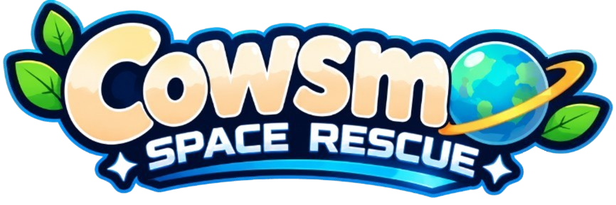

# 
Cowsmo: Space Rescue

  <strong>Videojuego de Plataformas 2.5D y Gestión Socioambiental</strong> 
  <em>"Explora el espacio, recicla recursos tecnológicos y devuelve la vida a la galaxia."</em>

  

  
  
  
  
  
  

<table>
  <tr>
    <td>
      

        
      

    </td>
    <td>
      

        
      

    </td>
  </tr>
  <tr>
    <td align="center"><b>Logo de Empresa</b></td> 
    <td align="center"><b>Logo de Proyecto</b></td>
  </tr>
</table>

---

## Resumen Ejecutivo

**Cowsmo: Space Rescue** es un videojuego de plataformas 2.5D enfocado en la restauración ambiental y la economía circular. Los jugadores acompañan a **Moo-ry**, una vaca astronauta del planeta sustentable Verdalia, en una misión por el planeta Nébularis para recuperar chatarra espacial (*E-Waste*), descontaminar los ecosistemas con el sistema **Bio-Bloom**, rescatar a los habitantes cautivos (**Nebulinos y Nebulos**) y construir el cohete *Cowsmo-1* para completar la huida.

### Por qué Cowsmo: Space Rescue
- **Impacto ODS (12, 13 y 15):** Concientización interactiva sobre el consumo responsable, la acción por el clima y la recuperación de ecosistemas terrestres.
- **Mecánica Bio-Bloom:** Transformación visual inmediata de entornos grises y contaminados a hábitats verdes y florecidos.
- **Eco-Crafting:** Sistema de procesamiento en taller donde los residuos recolectados se convierten en piezas y combustible para la nave.
- **Experiencia 2.5D Accesible:** Jugabilidad retro sobre rieles tridimensionales inspirada en clásicos como *Kirby 64*, apta para PC y dispositivos Android.

---

## Objetivos del Proyecto

### Objetivo General
Desarrollar un ecosistema de software multiplataforma compuesto por un videojuego 2.5D (PC/Android), una PWA y una aplicación móvil, que integre mecánicas de recolección de chatarra tecnológica y restauración de ecosistemas para concientizar a los jugadores sobre la economía circular y la remediación ambiental.

### Objetivos Específicos
- **Implementar mecánicas 2.5D interactivas:** Desarrollar el sistema de físicas para la "Pistola/Imán de Succión" y movimiento de plataformas en Unity 6.
- **Integrar el sistema visual "Bio-Bloom":** Crear transiciones dinámicas mediante *shaders* para transformar escenarios contaminados en entornos florecidos en tiempo real.
- **Construir una arquitectura de backend escalable:** Desarrollar una API REST con FastAPI/Node.js respaldada por una persistencia híbrida (MongoDB, MySQL, Redis) para gestionar el progreso (*Cross-Save*) y métricas.
- **Desarrollar plataformas complementarias:** Implementar una PWA (React) para clasificaciones globales y una *Companion App* (Flutter) para la gestión del perfil del jugador y recompensas.
- **Promover los Objetivos de Desarrollo Sostenible (ODS):** Alinear la narrativa y mecánicas del juego con los ODS 12, 13 y 15 de la ONU para generar un impacto socioambiental positivo.

---

## Problemática vs Solución

| El Problema | La Solución (Cowsmo: Space Rescue) |
| :--- | :--- |
| Vertederos clandestinos de chatarra tecnológica (*E-Waste*) que destruyen hábitats naturales. | Plataforma 2.5D donde la chatarra espacial es el recurso clave para avanzar y reparar el entorno. |
| Falta de herramientas interactivas y divertidas para enseñar la economía circular a jóvenes. | Sistema de *Eco-Crafting* que demuestra de forma práctica cómo transformar residuos en tecnología útil. |
| Degradación ambiental severa sin retroalimentación visual directa de recuperación. | Efecto *Bio-Bloom (%)* que devuelve la vida, el agua limpia y la vegetación al escenario en tiempo real. |

---

## Identidad Visual y Estética (Papercraft 2.5D)

### Dirección de Arte y Estética
- **Estilo Artístico (2.5D Papercraft):** Personajes y accesorios en recortes 2D planos (*cutout Sprites*) que se desplazan dentro de escenarios tridimensionales construidos como dioramas de cartón, empaques reciclados y material escolar/industrial.
- **Coherencia con el Mensaje Ambiental:** La estética de cartón y papel está reforzada de forma directa con la mecánica de **reciclaje (ODS 12)**; los objetos y estructuras del mundo lucen explícitamente reutilizados.
- **Animación & Efectos (VFX):**
  - **Efecto "Flip" de Papel:** *Moo-ry* y los enemigos giran sobre su eje como láminas de papel al cambiar de dirección.
  - **Transformación Bio-Bloom:** Al limpiar una zona, el entorno de cartón gris y doblado "se despliega" (*pop-up book*) revelando capas de papel maché y celofán de colores vivos y florecidos.
- **Interfaz de Usuario (UI):** Menús diseñados con texturas de etiquetas ecológicas, estampillas, recortes de papel kraft e iluminación neón suave en bordes.

### Paletas de Colores Oficiales

| **Protagonista e Identidad (Moo-Ry & Logo)** | **Entorno Limpio & Bio-Bloom (Verdalia)** |
| :---: | :---: |
|  |  |
| *Naranja cartulina, crema, azul visor y marrón corrugado.* | *Verde origami, verde esmeralda, amarillo celofán y azul agua.* |

| **Entorno Contaminado & Chatarra (Nébularis)** | **Interfaz de Usuario & Materiales (UI / HUD)** |
| :---: | :---: |
|  |  |
| *Gris industrial, marrón óxido, morado tóxico y verde neón.* | *Marrón kraft texturizado, rojo estampilla y blanco recorte.* |

---

## Diseño y Arquitectura del Sistema
> *Nota: Todos los esquemas y diagramas del proyecto reflejan la identidad visual del diorama de cartón (Papercraft) y etiquetas Kraft, alineándose con el ODS 12.*

### Diagrama de Arquitectura

  

### Diagrama de Roles de Usuario

  

### Modelo Business Canvas

  

---

## Tecnologías

| Capa | Herramientas |
| :--- | :--- |
| **Videojuego (Cliente)** | Unity 6 (URP), C#   |
| **Plataforma Web & App** | React + Vite (PWA), Flutter   |
| **Backend Services** | FastAPI (Python), Node.js (Express)   |
| **Bases de Datos & Caché**| MySQL, MongoDB, Redis    |
| **Seguridad & Monitoreo** | Keycloak, Grafana, Prometheus, Loki   |
| **Infraestructura & QA** | Docker Compose, Jira (Scrum), Git/GitHub    |

---

## Gestión del Proyecto

### Estructura Organizacional

  

### Cronograma (Gantt & Jira)

  

---

## Documentación y Entregables (GitHub Pages)

- [Página principal del proyecto](https://elmau0834x.github.io/Proyecto-Integrador-Cowsmo-Space-Rescue/index.html)
- [Práctica 04 · Business Model Canvas](https://github.com/elmau0834x/Proyecto-Integrador-Cowsmo-Space-Rescue/tree/main/Practica_04)
- [Práctica 05 · Diagrama de Roles de Usuario](https://github.com/elmau0834x/Proyecto-Integrador-Cowsmo-Space-Rescue/tree/main/Practica_05/imagenes)
- [Práctica 07 · Sketches y navegación](https://github.com/elmau0834x/Proyecto-Integrador-Cowsmo-Space-Rescue/tree/main/Practica_07)

---

## Nuestro Equipo

| Desarrollador | Rol | GitHub |
| :--- | :--- | :--- |
| **Mauricio Rosales Gabriel** | Líder de Proyecto / Programador Principal | [@elmau0834x](https://github.com/elmau0834x) |
| **Brisa Nallely García Gregorio** | Control de Calidad (QA) / Pruebas / Documentación / Jira | [@Brisgregorio](https://github.com/Brisgregorio) |
| **Carlos Daniel García Pluma** | Diseñador de Niveles 2.5D / Arte y Assets | [@DanielGarciaPluma](https://github.com/DanielGarciaPluma) |